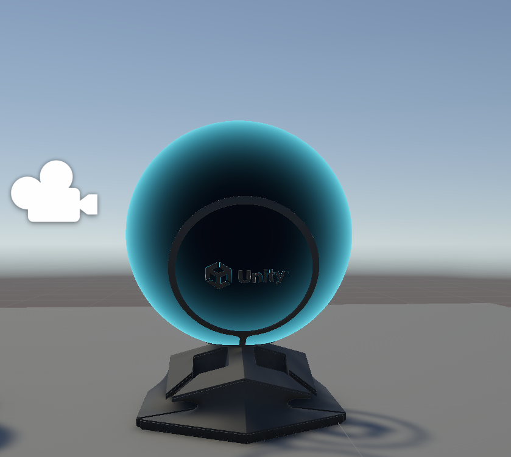
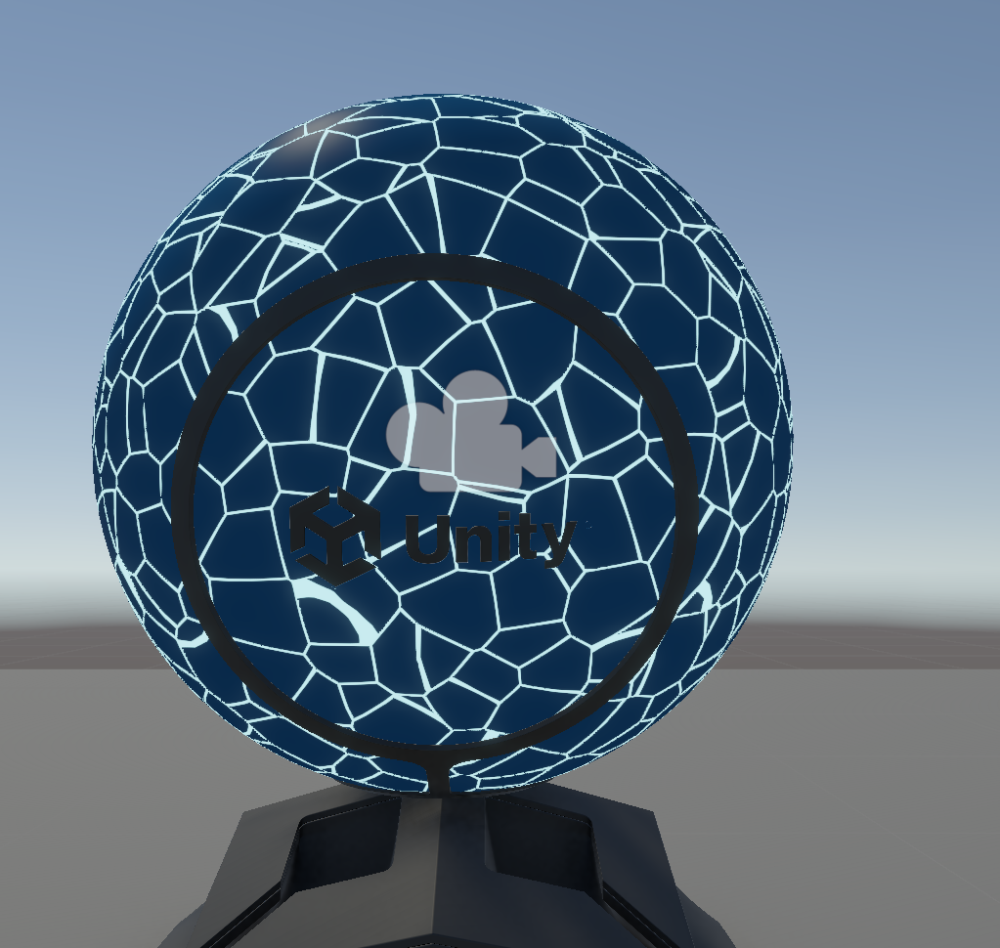
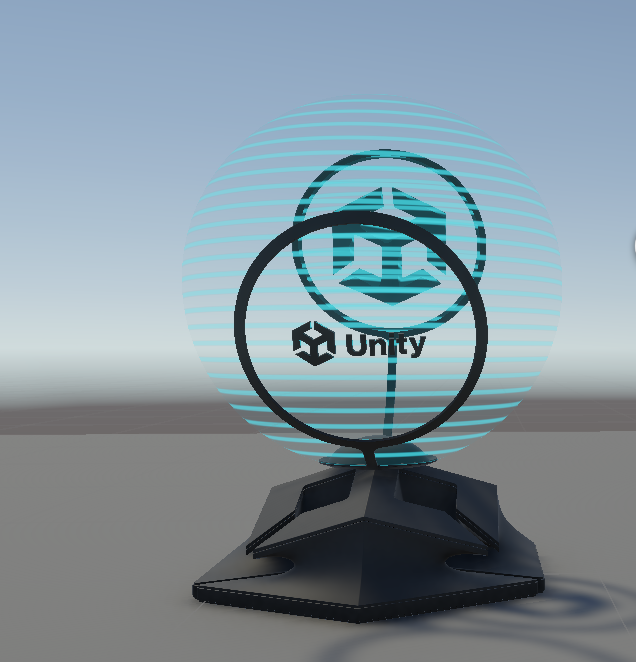

# 셰이더 3개

## 1. RimGlow — 가장자리가 빛나는 공

- **효과:** 어두운 공의 가장자리가 하늘색으로 빛난다.
- **원리:** 화면을 똑바로 향하는 부분은 어둡게, 비스듬히 보이는 가장자리는 밝게 칠한다.

## 2. IceCrystal — 금이 간 얼음 공

- **효과:** 푸른 공에 얼음이 갈라진 듯한 밝은 선이 생긴다.
- **원리:** 여러 점을 불규칙하게 놓고, 가장 가까운 두 점까지의 거리가 비슷한 곳에 선을 그린다. 이 선들이 이어져 균열처럼 보인다.

## 3. Hologram — 홀로그램 공

- **효과:** 뒤가 비치는 공에 청록색 가로줄이 위로 움직인다.
- **원리:** 높이에 따라 줄을 반복해서 그리고, 시간이 지날 때마다 줄의 위치를 바꾼다. 줄 사이를 더 투명하게 만들어 뒤쪽이 보이게 한다.
